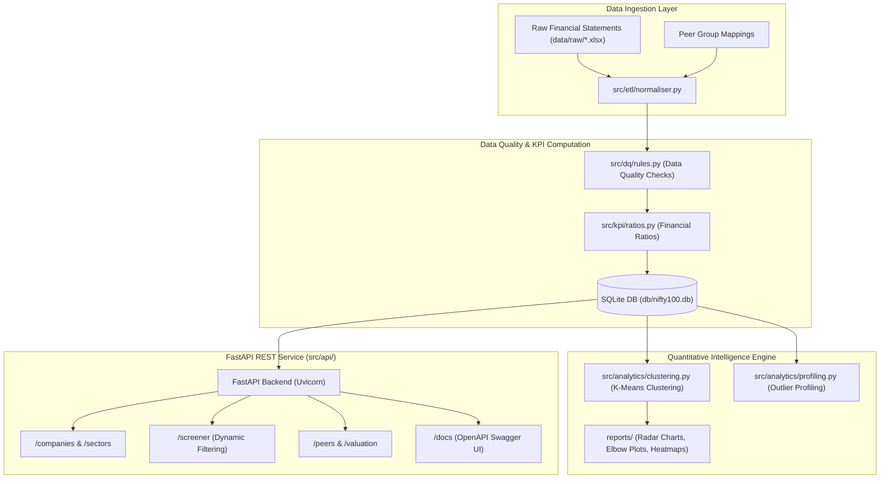
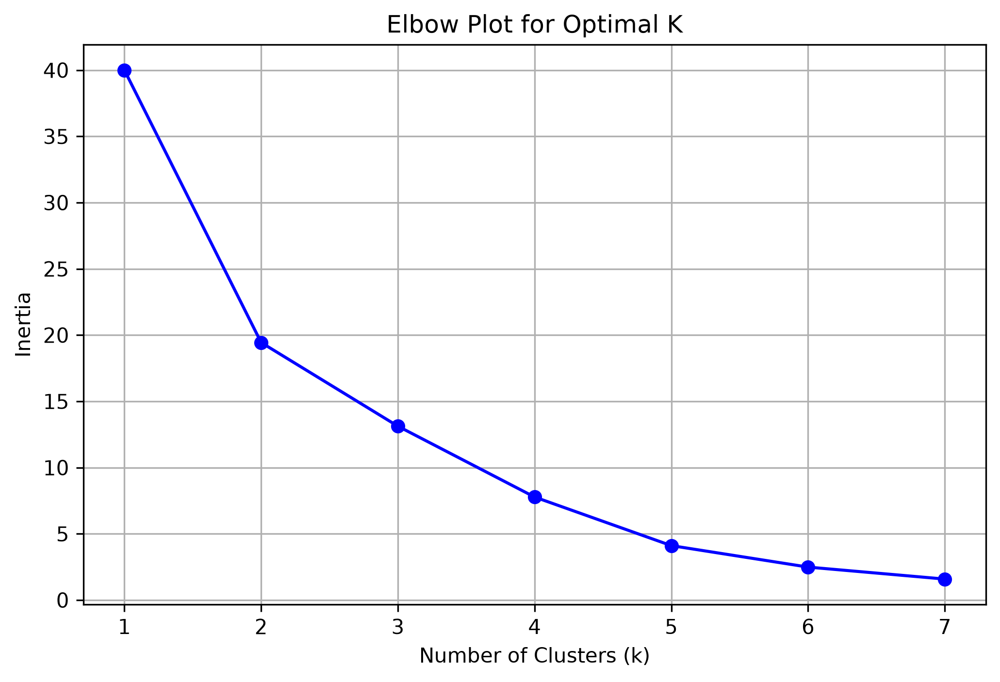
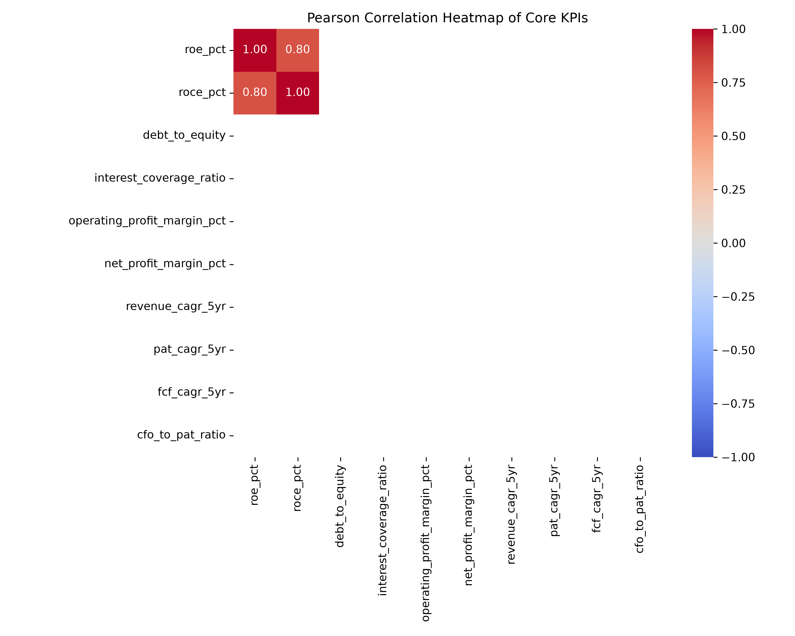
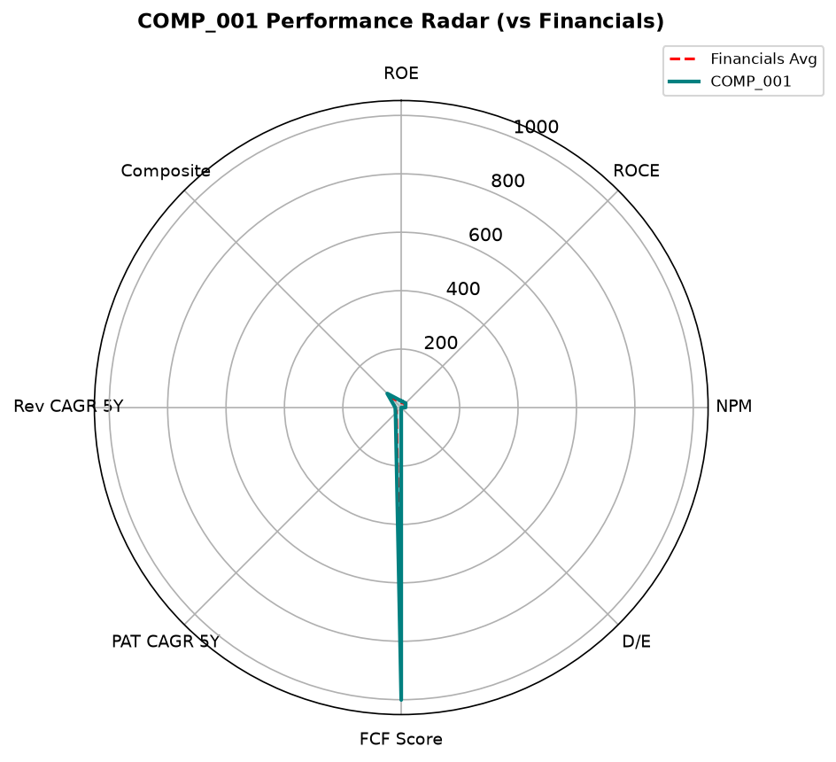

<div align="center">

# N100 Financial Intelligence Platform

<p>High-performance financial analytics backend, multi-factor stock screener, and automated valuation engine for Nifty 100 equities</p>


</div>

---


Retail and institutional market participants face significant latency when analyzing large equity baskets, cross-comparing sector multiples, and evaluating fundamental balance sheet health across premier index constituents. This platform solves that problem by establishing an automated quantitative intelligence pipeline: normalizing raw multi-year financial statements, computing rigorous fundamental ratios (ROE, ROCE, Operating Margin, Debt/Equity), clustering peer groups using unsupervised machine learning (K-Means), and exposing clean analytical endpoints through a production-grade FastAPI REST application.

---


- **Multi-Factor Stock Screener Engine**: Real-time parametric filtering across valuation multiples (P/E, P/B), profitability (ROE, ROCE), and financial leverage through `/api/v1/screener`.
- **Unsupervised Peer Clustering**: Scikit-Learn K-Means clustering pipeline identifying peer groups and factor similarities, with automated radar chart generation for each constituent.
- **Granular Financial Statements API**: High-throughput REST routes providing balance sheet structures, income statements, cash flow records, and derived financial indicators.
- **Automated Data Quality & Schema Validation**: Robust ETL normalizer (`src/etl/`) and rule-based validation checks (`src/dq/`) preventing corrupted or malformed metrics from entering the SQLite store.
- **Self-Documenting Interactive OpenAPI**: Comprehensive Swagger UI and ReDoc interface generated via strict Pydantic schemas accessible at `/docs`.
- **End-to-End Pipeline Runner & Test Suite**: Automated execution harness (`run_pipeline.py`) running profiling, clustering, and complete Pytest test suites with HTML report generation.

---


| Layer | Technology |
|---|---|
| **Backend Framework** | FastAPI, Uvicorn, Pydantic |
| **Core Language** | Python 3.10+ |
| **Data Processing & Analytics** | Pandas, NumPy, Scikit-Learn (K-Means Clustering) |
| **Relational Database** | SQLite (`db/nifty100.db`), Relational Schema |
| **Visualization & Reporting** | Matplotlib, Seaborn (Radar Charts, Heatmaps, Elbow Plots) |
| **Testing & Quality Assurance** | Pytest, Pytest-HTML |
| **DevOps & Containerization** | Docker, Docker Compose, GitHub Actions CI |

---




---


### Prerequisites
- Python 3.10 or higher
- Git
- (Optional) Docker & Docker Compose

### 1. Clone the Repository
```bash
git clone https://github.com/tejas-coder28/N100-FINANCIAL-INTELLIGENCE-PLATFORM.git
cd N100-FINANCIAL-INTELLIGENCE-PLATFORM
```

### 2. Environment Setup & Dependencies
```bash
# Create and activate virtual environment
python -m venv venv

# Windows (Command Prompt / PowerShell)
.\venv\Scripts\activate

# macOS / Linux
source venv/bin/activate

# Install required dependencies
pip install -r requirements.txt
```

### 3. Configure Environment Variables
Copy the template configuration file:
```bash
cp .env.example .env
```
Default parameters in `.env`:
```env
DB_PATH=db/nifty100.db
ENVIRONMENT=development
DEBUG=True
HOST=127.0.0.1
PORT=8000
WORKERS=1
API_V1_PREFIX=/api/v1
PROJECT_NAME="N100 Financial Intelligence API"
```

### 4. Run the Quantitative Pipeline
```bash
# Execute profiling, K-Means clustering, and automated test suite
python run_pipeline.py
```

### 5. Launch the API Server
```bash
# Start server with auto-reload
python run_server.py
```
Open your browser and navigate to `http://127.0.0.1:8000/docs` to interact with the live Swagger API interface.

### 6. Run Test Suite
```bash
pytest tests/ -v --html=reports/pytest_report.html
```

---


```
N100-FINANCIAL-INTELLIGENCE-PLATFORM/
├── config/                               # Screener YAML configuration parameters
├── data/                                 # Raw financial datasets & peer group mappings
├── db/                                   # SQLite production database file (nifty100.db)
├── docs/
│   └── assets/                           # Architecture charts and visualization screenshots
├── notebooks/                            # Exploratory data modeling Jupyter notebooks
├── reports/                              # Generated correlation heatmaps, elbow plots & radar charts
├── src/
│   ├── analytics/                        # K-Means clustering & outlier profiling algorithms
│   ├── api/                              # FastAPI routers, schemas, and server configurations
│   ├── dq/                               # Data quality and assertion validation rules
│   ├── etl/                              # Ingestion normalizers & schema transformation pipelines
│   ├── kpi/                              # Financial ratio calculation and valuation models
│   ├── reports/                          # Tearsheet generation & summary PDF builders
│   └── screener/                         # Multi-factor stock screening engine
├── tests/                                # Pytest unit and integration test suites
├── Dockerfile                            # Docker containerization configuration
├── docker-compose.yml                    # Multi-container orchestration specification
├── requirements.txt                      # Python runtime dependencies
├── run_pipeline.py                       # Master pipeline execution script
├── run_server.py                         # API web server bootstrapper
├── LICENSE                               # MIT License
└── README.md                             # Project documentation
```

---


### 1. Interactive Swagger API Documentation
*Explore and test REST routes directly via the interactive OpenAPI Swagger UI at `/docs`.*


> *TODO: Capture screenshot of the Swagger UI running at `http://127.0.0.1:8000/docs` and save to `/docs/assets/01_fastapi_interactive_docs.png`.*

### 2. K-Means Optimal Clustering Elbow Evaluation
*Distortion score evaluation identifying optimal clusters for peer group separation.*



### 3. Financial KPI Correlation Heatmap
*Cross-factor correlation matrix across liquidity, leverage, and valuation indicators.*



### 4. Constituent Factor Radar Chart
*Multi-factor performance scorecard mapping profitability, growth, and leverage.*



---


- **Live Market Feed Websockets**: Stream real-time equity prices into screener endpoints using NSE / BSE websocket connections.
- **Monte Carlo DCF Simulation**: Incorporate stochastic simulation for DCF intrinsic valuation under variable discount rates and terminal multiples.
- **Next.js Interactive Frontend**: Build a responsive React/Next.js dashboard consuming the API with real-time financial charting.

---


**Tejas Muralidhar**
- GitHub: [@tejas-coder28](https://github.com/tejas-coder28)
- LinkedIn: [Tejas Muralidhar](https://www.linkedin.com/in/tejasmuralidhar)
